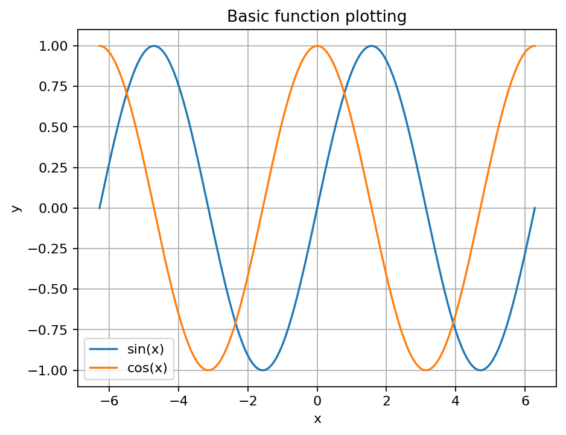
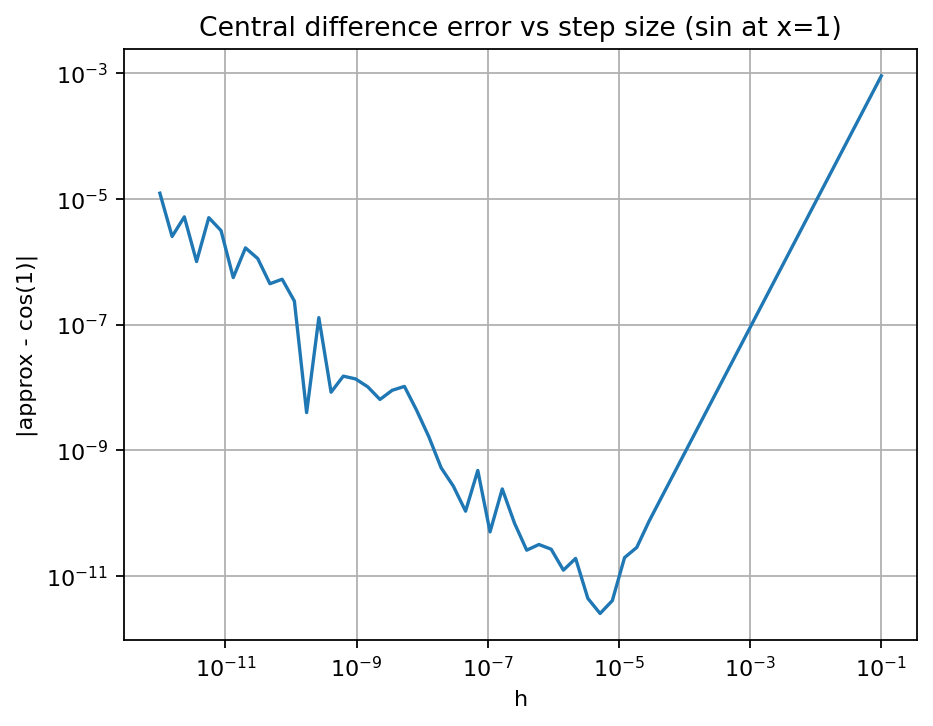
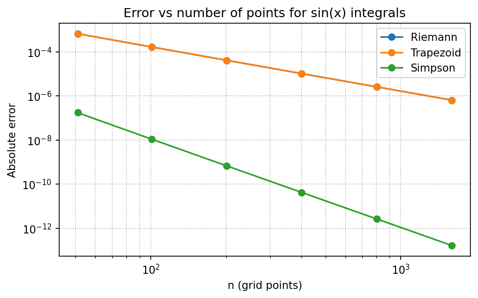
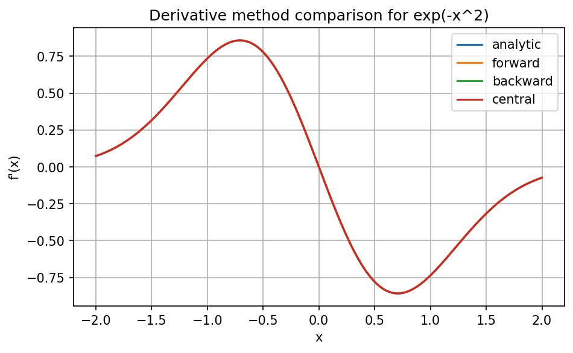

# calculus-with-python

[](https://github.com/calculus-with-python/calculus-with-python/actions)
[](https://www.python.org/)
[](LICENSE)

A small, educational repository to learn how to:
- plot mathematical functions in Python,
- approximate derivatives numerically,
- approximate integrals numerically,
- and build visual intuition with simple, well-tested code.

The focus is clarity and correctness, not maximum performance.

## What you’ll learn

### Plotting
- Build x-grids and evaluate functions safely
- Plot single and multiple functions
- Add labels, legends, limits, and annotations

### Numerical differentiation
- Forward / backward / central differences
- Step size trade-offs and numerical error
- Visualize the tangent line and derivative curves

### Numerical integration
- Riemann sums
- Trapezoidal rule
- Simpson’s rule
- Visualize area under the curve

## Repo layout
- `notebooks/`: guided lessons
- `src/`: small reference implementation
- `scripts/`: command-line demos
- `tests/`: correctness tests for numerical methods
- `assets/figures/`: generated images for README or docs

## Gallery

Snapshots from the notebooks help you see what the demonstrations produce.






## Learning path

See `docs/syllabus.md` for the full lesson plan, summary, and estimated time per notebook. The canonical order is:

| Notebook | Goals | Key outputs |
| --- | --- | --- |
| `01_plotting_functions.ipynb` | Build safe grids, evaluate functions without leaking errors, and plot multiple curves | Grid helpers, reusable plotting scaffolding, figure previews |
| `02_numerical_derivatives.ipynb` | Compare forward/backward/central differences, visualize truncation vs rounding error, and align against symbolic derivatives | Tangent/derivative plots, error vs. `h`, symbolic comparison figure |
| `03_numerical_integration.ipynb` | Explore Riemann, trapezoid, Simpson, and symbolic definite integrals | Area plots, convergence chart, symbolic error bars |
| `04_mini_projects.ipynb` | Apply the helpers to extrema detection, π approximation, and method comparisons with practice exercises | Mini-project figures, π error plot, integration comparison visuals |

## Documentation

- [Concepts](docs/concepts.md) summarizes the grids, domain restrictions, numerical error, and stability concerns that guide the helpers.
- [Gallery](docs/gallery.md) lets you scan the `gallery_*.png` catalog of functions, domains, and asymptotic behavior.
- [CONTRIBUTING.md](CONTRIBUTING.md) explains how to run the tests, linters, and notebooks before opening a pull request.

## Setup

This project targets Python 3.11–3.12; install one of those runtimes before running the commands below.

### Option A: Poetry
```bash
poetry install
poetry run python -c "import calculus_with_python as c; print(c.__version__)"
```

Install the optional symbolic extra (`poetry install -E symbolic`) to enable `calculus_with_python.symbolic` and the SymPy-powered helpers.

### Option B: pip (editable)
```bash
python -m venv .venv
source .venv/bin/activate
pip install -U pip
pip install -e .
```

## Quickstart

Use the provided Makefile targets to exercise the common workflow without setting `PYTHONPATH`:

```bash
make install
make test
make lint
make typecheck
make run-demos
```

Run `make fmt` to automatically format the Python sources with Ruff.


## Optional symbolic support

Install the symbolic extra to enable SymPy-backed helpers for parsing and evaluation.

```bash
poetry install -E symbolic
```

```python
import numpy as np
import matplotlib.pyplot as plt

from calculus_with_python.symbolic import lambdify_expr, symbolic_derivative

expr = "sin(x) + x**2"
sym_deriv = symbolic_derivative(expr)
fn = lambdify_expr(sym_deriv)
xs = np.linspace(-2.0, 2.0, 400)
plt.plot(xs, fn(xs), label="symbolic derivative")
plt.title("Symbolic derivative via SymPy")
plt.legend()
plt.show()
```

## CLI demos

Use the `calcwithpy` CLI to run plots, derivatives, or integrals without editing code. The script ships as a Poetry entry point:

```bash
poetry run calcwithpy plot --expr "sin(x)" --a -6.28 --b 6.28 --n 1000 --out assets/figures/cli_plot.png
poetry run calcwithpy diff --expr "sin(x)" --x0 1.0 --h 1e-5 --method central
poetry run calcwithpy integrate --expr "sin(x)" --a 0 --b 3.14159 --n 2001 --method simpson
```

Custom expressions beyond the predefined `sin(x)`, `cos(x)`, `exp(x)`, `x**2`, and `log(x)` require installing the symbolic extra (`poetry install -E symbolic`).

## How to use this repo

- **For students:** follow the [course overview](docs/index.md), work through the notebooks in order (see the table above), run the figures via `poetry run jupyter lab` or `make run-demos`, and consult `docs/faq.md` if you run into environment issues.
- **For instructors:** use the `notebooks/` and `assets/figures/` outputs to prepare lessons, reference `docs/syllabus.md` for timing, and extend `docs/faq.md` and `docs/concepts.md` with any site-specific guidance. Encourage contributors to read `CONTRIBUTING.md` before submitting changes.

## Run notebooks
```bash
pip install jupyter
jupyter lab
```

## Run demos
```bash
python scripts/plot_function.py
python scripts/derivative_demo.py
python scripts/integration_demo.py
```

Each script now prepends `src/` to `sys.path`, so these commands work without setting `PYTHONPATH`, or just run `make run-demos`.

## Contributing

Please read [CONTRIBUTING.md](CONTRIBUTING.md) for details on running the test suite, linting, and refreshing notebooks before submitting changes.

## License
MIT.
