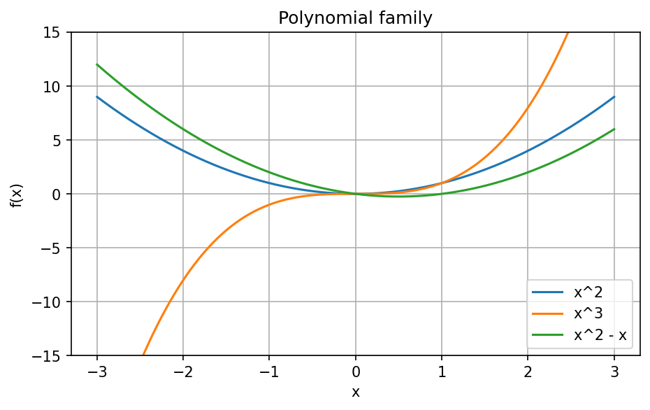
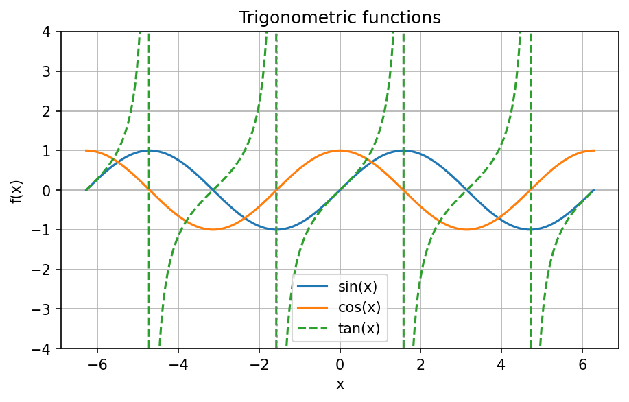
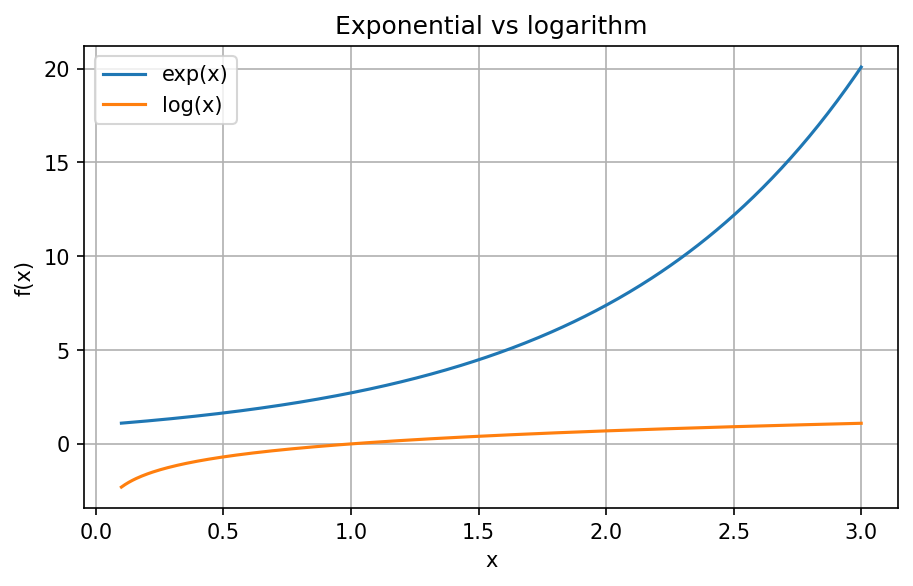
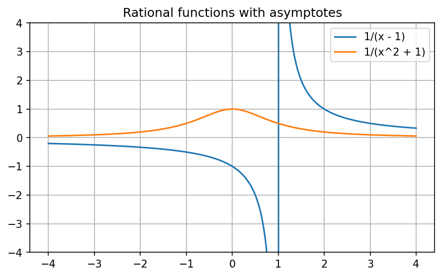
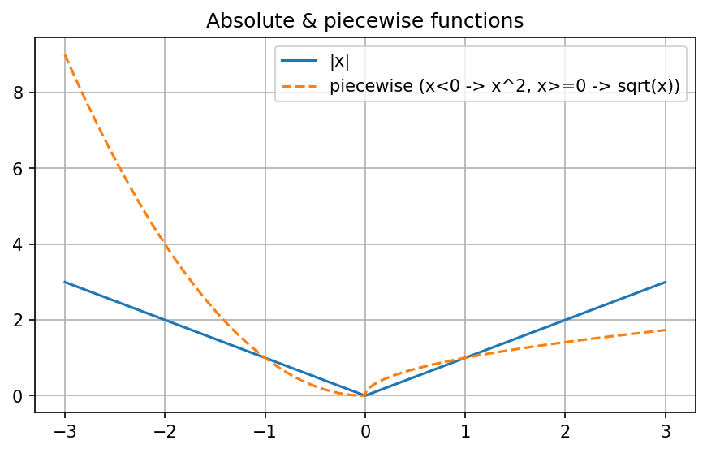

# Function gallery

Browse these figures for a visual catalog of common functions, their domains, asymptotes, and scaling behavior.

## Polynomials

- **Domain:** all real numbers.
- **Notes:** quadratic/cubic growth dominates for large |x|. The figure shows symmetric and skewed variants.

## Trigonometric functions

- **Domain:** all real values; `tan(x)` has vertical asymptotes at ±π/2, ±3π/2, …
- **Notes:** sin/cos are bounded and 2π-periodic while tan alternates sign mid-period. The gray lines mark asymptotes.

## Exponential and logarithm

- **Domain:** `exp(x)` defined everywhere; `log(x)` requires x > 0, with a vertical asymptote as x → 0⁺.
- **Notes:** Exponential growth quickly outpaces log, which slowly increases in its domain.

## Rational functions

- **Domain:** `1/(x-1)` excludes x = 1 (vertical asymptote); `1/(x²+1)` defined everywhere and decays like 1/x² as x → ±∞.
- **Notes:** The plateau near zero and the asymptotic behavior showcase different regimes of the family.

## Absolute and piecewise

- **Domain:** all real numbers.
- **Notes:** `|x|` is symmetric with a cusp at zero; the piecewise plot has quadratic growth left of zero and a square-root branch to the right.
